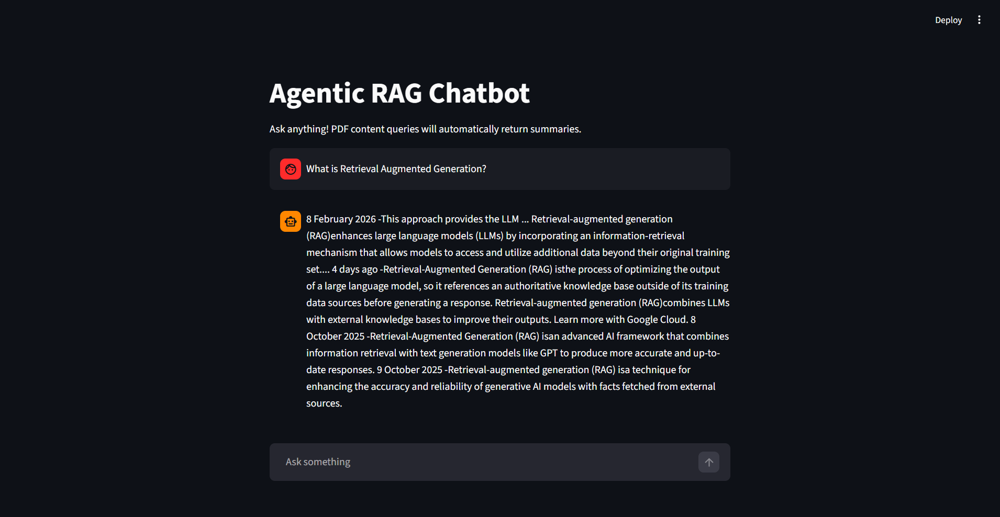
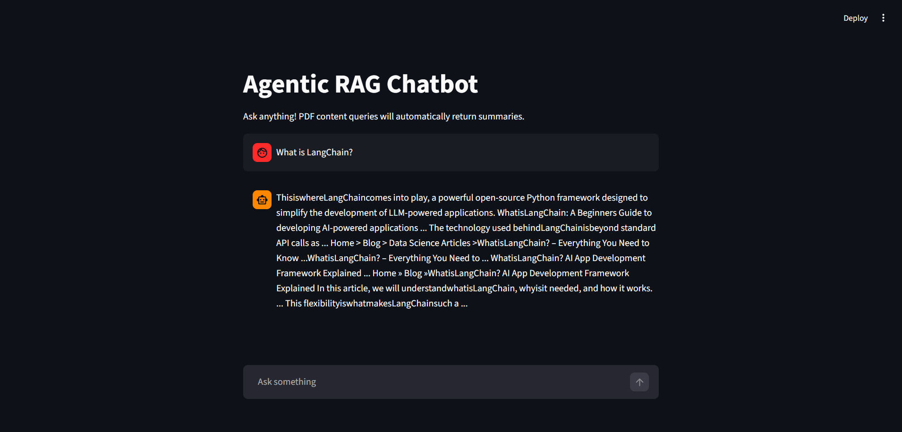
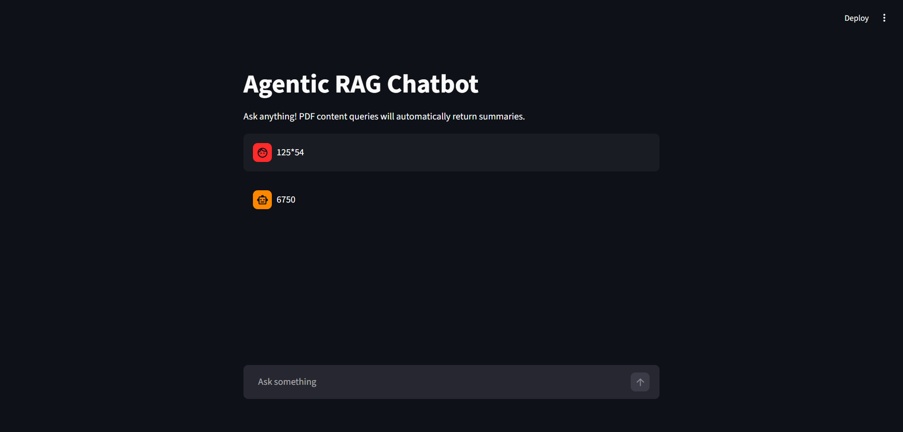

# 🤖 Agentic RAG Chatbot using LangChain
An AI agent that combines **RAG, web search, and tools** to answer questions using **LangChain, FastAPI, and Streamlit**.


<p align="center">
  
</p>

An **Agentic Retrieval-Augmented Generation (RAG) chatbot** built using **LangChain, FastAPI, Streamlit, and local tools**.

The system combines **LLM reasoning, tool usage, and knowledge retrieval** to answer user queries intelligently.

It supports:

* Knowledge base retrieval (RAG)
* Web search
* Calculator tool
* Interactive chat interface
* API-based access

---
# Why This Project

Large Language Models often hallucinate when answering questions.

This project demonstrates how **Retrieval Augmented Generation (RAG)** combined with **tool-based agents** can improve reliability by retrieving real knowledge from documents and external tools.

---

# Project Overview

This project implements an **Agentic AI system** capable of answering questions using **multiple tools and knowledge sources**.

The architecture integrates:

* **LangChain Agent**
* **Retrieval Augmented Generation (RAG)**
* **FastAPI backend**
* **Streamlit user interface**

The agent can decide **which tool to use depending on the user query**, enabling intelligent reasoning.

Example capabilities:

* Retrieve answers from a knowledge base
* Perform calculations
* Search the web
* Provide conversational responses

---
# RAG Pipeline

The Retrieval-Augmented Generation pipeline works in the following steps:

1. Load PDF documents
2. Split text into smaller chunks
3. Generate embeddings using Sentence Transformers
4. Store embeddings in a FAISS vector database
5. Retrieve relevant chunks based on user query
6. Pass context to the LLM for answer generation

---
# Demo

### Streamlit Chat Interface

<p align="center">
  
</p>

---

### Tool Usage Example

<p align="center">
  
</p>


---

# Tech Stack

### Programming Language

* Python

### AI / LLM Framework

* LangChain
* Ollama

### Backend

* FastAPI
* Uvicorn

### Frontend

* Streamlit

### Vector Embeddings

* Sentence Transformers

### Tools

* Web Search (DDGS)
* Calculator
* Knowledge Base Retrieval

---

# System Architecture

```
User Query
     │
     ▼
Streamlit Chat Interface
     │
     ▼
FastAPI Backend
     │
     ▼
LangChain Agent
     │
 ┌───┼───────────────┐
 │   │               │
 ▼   ▼               ▼
RAG Tool     Web Search Tool     Calculator Tool
 │
 ▼
Vector Database
 │
 ▼
Final Response to User
```

---

# Project Structure

```
agentic-rag-chatbot
│
├── app
│   ├── agent
│   │   └── agent.py
│   │
│   ├── api
│   │   └── api.py
│   │
│   ├── rag
│   │   ├── ingest.py
│   │   ├── rag_pipeline.py
│   │   └── prompt_template.py
│   │
│   ├── tools
│   │   ├── web_search_tool.py
│   │   ├── search_tool.py
│   │   ├── calculator_tool.py
│   │   └── rag_tool.py
│   │
│   ├── ui
│   │   └── streamlit_app.py
│   │
│   └── images
│       ├── ui.png
│       ├── tool_usage.png
│       └── api_docs.png
│
├── vectorstore
├── requirements.txt
└── README.md
```

---

# Installation

Clone the repository

```
git clone https://github.com/Flash6699/agentic-rag-chatbot.git
cd agentic-rag-chatbot
```

Create virtual environment

```
python -m venv venv
```

Activate environment

Windows

```
venv\Scripts\activate
```

Install dependencies

```
pip install -r requirements.txt
```

---

# Running the Project

### Start FastAPI server

```
python -m uvicorn app.api.api:app --reload
```

Open API docs

```
http://127.0.0.1:8000/docs
```

---

### Run Streamlit UI

```
streamlit run app/ui/streamlit_app.py
```

Open browser

```
http://localhost:8501
```

---

# Example Queries

You can ask questions like:

```
What is Retrieval Augmented Generation?
Explain transformers in simple terms
What is 125 * 83?
Search latest news about AI
Who is the current president of India?
```

---

# Key Features

* Agent-based reasoning using LangChain
* Retrieval Augmented Generation (RAG)
* Multiple tool integration
* FastAPI backend API
* Interactive Streamlit chat UI
* Modular project architecture

---

# Future Improvements

* Add conversation memory
* Deploy using Docker
* Add more external tools
* Cloud deployment (AWS / HuggingFace)
* Add authentication and logging

---

# Author

**Vedant Shinde**

Machine Learning & Generative AI Enthusiast

GitHub  
https://github.com/Flash6699

---

# License

This project is licensed under the **MIT License**
